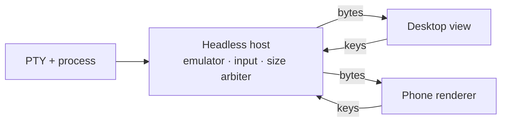

I want to check on a coding agent from my phone: see what it's doing, answer its question, approve a step, put the phone away. We're building this for Grove's iOS companion, but the problem is general — stream a live terminal from a desktop to a phone, securely, without the slow end dragging down the fast one. None of this is built yet. This is the design, with the parts I haven't verified marked as open.

## The phone is a client, not a host

The obvious first idea is to run the agent on the phone. You can't. An iOS app can't `fork`, `exec` or `posix_spawn`, and a terminal coding agent needs a real OS underneath it anyway: a shell, a toolchain, the repository on disk. So the PTY stays on the desktop and the phone renders it and sends keystrokes back.

## Step one: take the PTY away from the view

In a lot of terminal apps the view owns everything: it spawns the process, holds the emulator, and reads the PTY. That works until you want a second screen. Before any networking, the process has to move into a headless layer that doesn't care who's watching:



The host owns the process, a headless emulator that always holds the current screen, a fan-out of output to subscribers, a single input path, and one arbiter for the terminal size. The desktop view becomes one renderer among others.

One gotcha worth knowing: a program can *ask* the terminal things — cursor position (`CSI 6n`), device attributes (`CSI c`) — and expects exactly one answer on stdin. If three emulators parse the same byte stream, all three answer, and the program reads garbage. Only the host's emulator may reply; every renderer has to drop its replies on the floor.

## What goes over the wire

There are three reasonable answers.

- **Raw PTY bytes.** Cheap and exact. But a client that joins late starts in the middle of an escape sequence with no idea what mode the terminal is in, and on a slow link a burst of output just queues up.
- **Screen-state diffs**, the way mosh does it. Robust, bandwidth bounded by screen size rather than output rate, late joiners are trivial. It's also a lot more work: your own screen model and diff protocol.
- **A hybrid**, which is what I picked. On attach, the host serializes its current screen as ordinary VT sequences — clear, cursor moves, attributes, text — and sends that snapshot. After that it sends live raw bytes, each chunk tagged with its byte offset in the stream.

The offsets are what make it hold together. The host keeps recent output in a ring buffer. On reconnect, the client says "I have everything up to offset N"; if N is still in the buffer, the host resumes from there, otherwise it sends a fresh snapshot. Backpressure works the same way: each client has a bounded queue, and when it overflows the host drops the pending bytes and queues a snapshot instead.

```text
on output(chunk):
    start = ring.append(chunk)              # offset of chunk's first byte
    for client in subscribers:
        if client.queue.bytes + chunk.size > LIMIT:
            client.queue.clear()
            client.queue.push(Snapshot(host.screen, offset: start + chunk.size))
        else:
            client.queue.push(Bytes(chunk, offset: start))
```

A slow phone sees the screen jump forward. It never stalls the host, and it never stalls another client.

A plain text transcript isn't an option: coding agents are full-screen TUIs that redraw regions and use the alternate screen.

## One PTY, one size

A PTY has exactly one window size, and a phone is much narrower than a desktop window. Reflowing to the phone's width would scramble the desktop view, so:

- **Viewing** keeps the host's size. The phone zooms and scrolls.
- **Take control** resizes the PTY to the phone, and releasing it restores the previous size.
- **Latest controller wins.** No negotiation, no locking.

## Transport: QUIC, with a TCP fallback

QUIC fits this well. One control stream plus one stream per attached terminal means a terminal dumping a build log can't head-of-line-block the one you're actually typing into. Connection migration lets a session survive a move from Wi‑Fi to cellular. TLS 1.3 is built in rather than layered on.

Some networks block UDP, so the fallback is plain TCP with TLS 1.3 and length-prefixed frames, multiplexed by a stream ID in the frame header.

Off the local network, the plan is to ride the user's own VPN — Tailscale, WireGuard — rather than run a relay, which would be infrastructure to operate and a place where terminal traffic passes through someone else's machine.

## Security: this is remote code execution

A remote that can type into a shell can run anything as you. Every decision here follows from that.

- **Off by default.** Nothing listens until you turn it on.
- **Pairing by QR code.** The code carries the host's endpoint, its public-key fingerprint, and a one-time 256-bit secret. The phone uses that secret as a TLS 1.3 pre-shared key for the first connection, then both sides exchange a long-term per-device key and store it in the OS keychain. The one-time secret is never valid again.
- **Not a 6-digit code.** It's tempting because it's easy to type, but a PSK handshake is checkable offline: anyone who captures one can try all million codes on their own machine afterwards. A short code only works with a PAKE-style exchange, which is more machinery than a camera and a QR code.
- **Per-device revocation and scopes.** Each paired phone can be revoked on its own, and has a scope: *view* or *control*.
- **A visible indicator on the host** whenever a remote is attached. You should never be surprised that someone is watching your terminal.
- **No commands from the wire.** The remote can attach to a session that already exists, or ask the host to start one through the host's own policy. It never sends a command line or an argv to run.
- **Bracketed paste for multi-line input**, so a pasted block arrives as text and its newlines don't submit line by line.

## Performance

Most of this is about not doing work:

- **Coalesce output.** Flush every ~16 ms or every few KB, whichever comes first. Agents emit lots of tiny writes.
- **Compress only if measurements say so.**
- **Only the visible terminal streams bytes.** The others send metadata — title, running/exited, exit status — and get a snapshot when you switch to them.
- **Get off the UI thread fast.** PTY reads, parsing and networking run elsewhere.
- **Assume the client gets suspended.** iOS suspends a backgrounded app within seconds. So resume-by-offset isn't an optimisation, it's the normal path: every time you unlock your phone, you're reconnecting.

Push notifications ("the agent is waiting for you") would need a server to relay them. That's out of scope for now.

## What I don't know yet

These are open, and I'm measuring them before writing much code:

- **QUIC with a TLS 1.3 PSK.** Whether the platform networking stack accepts an external pre-shared key on a QUIC connection, and whether that mode keeps forward secrecy (PSK with an ephemeral key exchange) or falls back to PSK-only. If it doesn't, the pairing step changes.
- **Snapshot fidelity.** Whether the terminal emulator library exposes enough state — cells, attributes, cursor, modes like the alternate screen and bracketed paste — to serialize a snapshot that reproduces the screen exactly. A snapshot that's almost right is worse than none.
- **Real output rates.** How many bytes per second coding-agent TUIs actually produce while they work, and how well that compresses. That decides the queue limits, the coalescing window, and whether compression earns its place.

The part I'm most sure of is the first step. Pulling the PTY out of the view is worth doing even if the phone never ships, because it's what turns "a terminal window" into "a terminal that anything can attach to" — and everything else here is just choosing who's allowed to.
