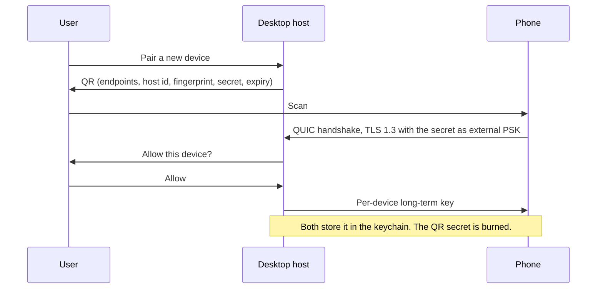
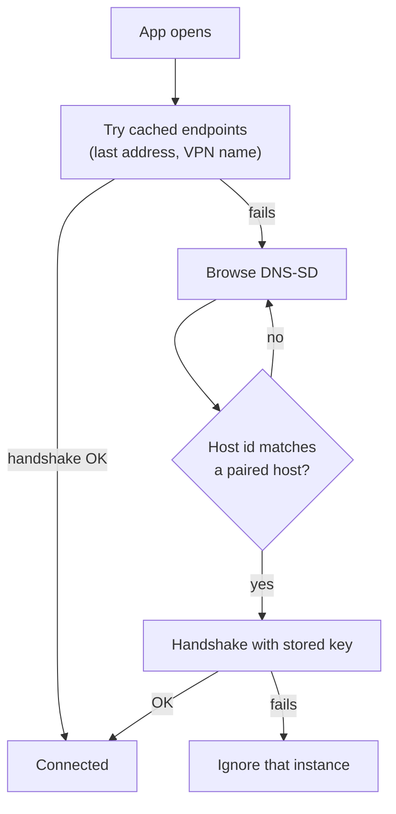

The [first post](/blog/2026/11/10/streaming-a-terminal-to-a-phone/) covered the shape of the problem — a headless PTY host, snapshot-then-bytes streaming, one window size — and waved at the network with "QUIC, with a TCP fallback" and "pairing by QR code". This one fills that in. It's for Grove's iOS companion, but nothing below depends on that, and none of it is built yet.

## QUIC, the parts that matter here

QUIC runs over UDP and does what TCP and TLS do together — reliable delivery, congestion control, encryption — plus multiplexing, which TCP never had.

- **TLS 1.3 is the handshake.** QUIC's handshake carries the TLS 1.3 messages, so a new connection is ready after one round trip. Resumption allows 0-RTT data, but early data can be replayed by anyone who captured it, so nothing that changes state — and a keystroke into a shell does — goes in 0-RTT.
- **ALPN is mandatory.** Both sides must agree on an application protocol name or the handshake fails. That's where an identifier like `myterm/1` lives, and a client speaking something else is rejected before any application data flows.
- **Almost everything is encrypted.** Payloads are encrypted and authenticated; header protection hides the packet number and some flag bits. Little more than the version and connection IDs stays visible.
- **Connections aren't tied to an address.** TCP identifies a connection by its 4-tuple, so changing networks kills it. QUIC uses connection IDs, so a phone moving from Wi‑Fi to cellular keeps the connection and sends from the new address. The server validates the new path with a challenge/response before trusting it, and the client switches to a fresh connection ID so an observer can't trivially link the two paths.
- **Streams are cheap and independent.** A connection carries many streams, bidirectional or unidirectional, opened without a round trip, each ordered on its own.

That's the main reason to pick QUIC here. Say two terminals are attached: one running a build that's dumping a log, one where an agent is waiting for your answer. Over one TCP connection they share a single ordered byte stream. Lose one packet of build log and every byte after it — including the echo of the key you just typed in the other terminal — waits until that packet is retransmitted. That's head-of-line blocking. Over QUIC each terminal is its own stream, so the loss stalls the build log and nothing else.

- **Flow control is credit-based**, per stream and per connection. The receiver advertises how many bytes it will buffer; the sender can't exceed that until more credit arrives. A phone that stops reading stops granting credit — a backpressure signal for free.
- **Loss recovery is unambiguous.** Packet numbers only go up; lost data is resent in a new packet with a new number, so an ack always identifies which transmission arrived and RTT samples stay clean. Congestion control is pluggable (NewReno-style in the RFC; CUBIC or BBR in many stacks).
- **Unreliable datagrams exist** (RFC 9221): congestion-controlled but never retransmitted. They suit data where a late value is worthless, like a cursor position. Terminal output isn't that — one missing byte corrupts every escape sequence after it — so it goes on streams.

The catch is that UDP gets blocked; some corporate and hotel networks allow little beyond TCP 443. The fallback is TLS 1.3 over TCP with streams multiplexed in the frame header, which brings head-of-line blocking back. It's a degraded mode, not an equivalent one.

On Apple platforms, Network.framework supports QUIC directly, with streams exposed as a group over one connection.

## Sending the data

One connection: a **control stream** for everything that isn't terminal output (hello, session list, attach, resize, input), and **one stream per attached terminal** for its output.

QUIC gives you bytes, not messages, so you still need framing:

| Field | Size | Notes |
| --- | --- | --- |
| Length | 4 bytes, big-endian | Size of what follows. Capped (say 1 MiB); larger closes the stream. |
| Type | 1 byte | Hello, Snapshot, Bytes, Input, Resize, … |
| Payload | Length − 1 bytes | Type-specific. |

Not newline-delimited: terminal output is full of newlines and arbitrary bytes, so you'd be escaping and scanning every one. A length prefix lets the reader read exactly one frame and skip a type it doesn't know. Cap it — a length field is an allocation request from the other side.

The first frame each way on the control stream is a **Hello** with the minimum and maximum protocol versions that side speaks; the host picks the highest common one or closes with a clear error. ALPN pins the protocol family, Hello picks the revision.

On a terminal stream, attaching sends a **Snapshot** (the screen serialized as VT sequences, tagged with the stream offset it represents), then **Bytes** frames tagged with the offset of their first byte. QUIC already orders a stream, so the offset isn't for ordering; it's for the *next* connection. On reconnect the phone says "I have everything up to N", and the host resumes from its ring buffer or sends a fresh snapshot.

**Coalesce.** Agents produce lots of tiny writes, and a frame per write means a packet, an ack and a radio wake-up per write. Flush every ~16 ms (about one frame at 60 Hz) or every few KB, whichever comes first.

**Compress only after measuring.** Terminal output compresses well, but only with a per-stream context; compressing each small frame alone does little. And compressing attacker-influenced text (a file from a repository) together with secrets (a token printed in your shell) leaks through ciphertext sizes — the CRIME/BREACH class of attack. Narrow here, but a reason not to compress by default.

**Backpressure.** Flow control tells the host a phone is slow; the application decides what to do. The PTY reader never blocks. Each client gets a bounded queue in the host, and the host writes into the QUIC stream only as fast as it accepts data — keep the transport's send buffer small, because data handed to the stream can't be withdrawn, while data still in your queue can. On overflow the host drops the queue and sends a snapshot instead. The phone's screen jumps; nothing else slows down.

**Control message encoding** is about evolution, not speed. Numbered fields (Protocol Buffers) or a self-describing format (CBOR) both work, under the same rules: only add fields, never repurpose one, ignore what you don't recognise, and bump the version in Hello for anything a reader must understand.

## What the QR code carries

The QR code moves a secret from the desktop to the phone without touching the network. It carries:

- **Protocol version**, so an old phone can say "update me" instead of failing strangely.
- **Host identity**: a random host ID and the host's key fingerprint.
- **Endpoint candidates**: the LAN address and port, plus a VPN name if there is one (a tailnet hostname, say).
- **A one-time 256-bit secret** and an **expiry** a few minutes out.

The secret must be high-entropy because of how TLS 1.3 pre-shared keys work. The client proves it knows the PSK with a *binder* in its ClientHello — an HMAC keyed from the PSK. Anyone who captures that ClientHello can guess PSKs offline and check each against the binder. A 6-digit code is a million guesses: nothing. 256 random bits is hopeless. If people really must type a short code, use a PAKE (SPAKE2, CPace), where every guess needs a live exchange with the real host.

1. The phone connects using the one-time secret as an **external PSK**. A successful handshake proves both sides saw the same code.
2. The host asks the user to approve the device by name. Seeing a QR code isn't consent.
3. The two sides set up a **per-device long-term key** — a fresh random key sent over the protected channel, or one derived with HKDF from a TLS exporter value — and store it in the OS keychain.
4. The one-time secret is deleted, whatever the outcome.

A PSK alone (`psk_ke`) has no forward secrecy: whoever later steals the key can decrypt recorded traffic. TLS 1.3's `psk_dhe_ke` mode adds an ephemeral (EC)DHE exchange, so it does — that's the mode to require. **Open:** whether the platform's QUIC stack accepts an external PSK at all, and whether it negotiates `psk_dhe_ke`. External PSKs are well-defined in TLS 1.3 but far less exercised than certificates.

Two things are easy to get wrong:

- **The fingerprint is identity, not authentication.** It tells the phone *which* host it found. Anyone can copy a fingerprint; what proves the host is real is completing a handshake with the shared key.
- **The QR code is a secret on a screen.** It can be photographed over a shoulder or caught in a screen share. Short expiry, single use and explicit approval are what make that survivable.

Revocation is deleting the device's key on the host. Its next handshake fails.

## How the phone finds the desktop

The address in the QR code goes stale the next time DHCP hands out a new lease, so the phone needs to find the host again.

On a local network that's **DNS-SD over multicast DNS** — Bonjour. The host advertises an instance of a service type like `_myterm._udp` (UDP, because QUIC), with a port and a TXT record. The phone browses for that type, resolves an instance to an address, connects, and authenticates with its stored key.

Every device on the network can read the TXT record, so it carries only non-secret metadata: the random host ID and the protocol version. No keys, no tokens — and think twice before broadcasting the computer's name as the instance name.

mDNS is link-local: routers don't forward its multicast, so discovery only works on the same segment. Guest and corporate Wi‑Fi often block multicast or isolate clients, and most VPNs don't carry it. Off the LAN, the phone uses the VPN name from the QR code — not a relay, which is infrastructure to run and a third party in the path of terminal traffic.

**An advertisement is a hint, never proof.** Anyone on the network can advertise your host ID; only the handshake with the stored key counts. In practice the cached endpoints and the browse can race, and whichever authenticates first wins.

The platforms make you ask first:

- **iOS** shows a Local Network privacy prompt before an app can browse or connect locally. The app needs a usage string (`NSLocalNetworkUsageDescription`) and must list every service type it browses (`NSBonjourServices`). If the user declines, browsing fails with a policy error that's easy to mistake for "nothing found" — notice it and say why.
- **macOS** gates local network access for apps too, and with the application firewall on, the user is asked to allow incoming connections the first time the host listens.

## What I'm measuring

- **QUIC with an external PSK in `psk_dhe_ke` mode on the platform stack.** If it isn't there, pairing switches to exchanging public keys over the one-off channel and pinning certificates afterwards — more moving parts, same guarantees.
- **How often UDP is actually blocked** on the networks people use, which decides whether the TCP fallback is an edge case or a path that needs real attention.
- **Whether multicast discovery is reliable enough to lead.** If it fails often on real Wi‑Fi, endpoints from the QR code — refreshed after every successful connection — become the primary path and Bonjour the fallback.
